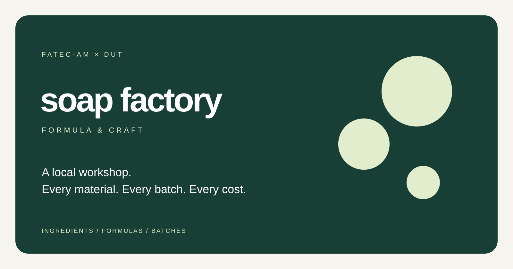
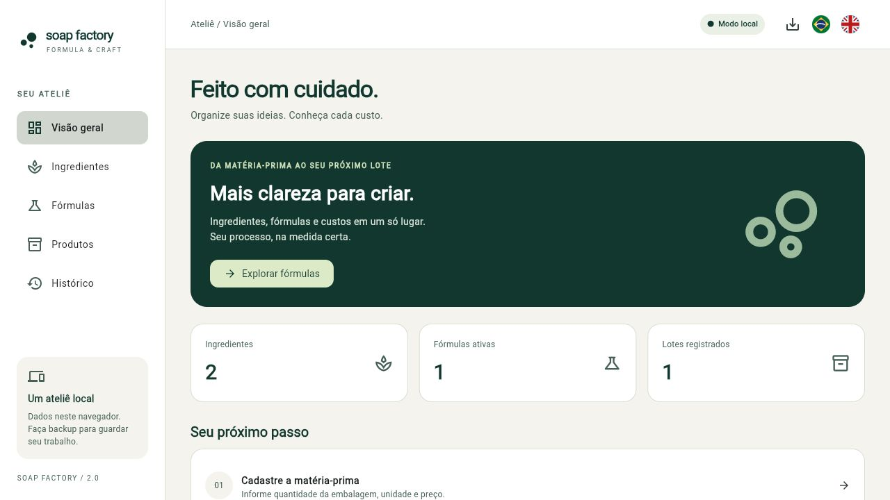
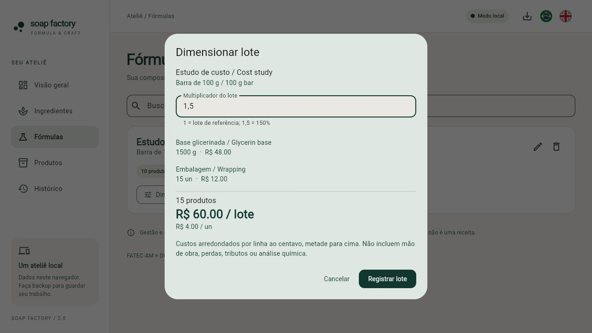
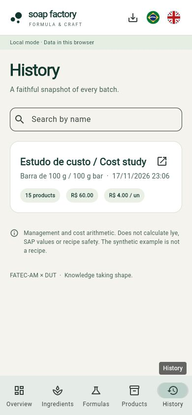

# Soap Factory · Formula & Craft



[](https://docs.flutter.dev/release/release-notes)
[](pubspec.yaml)
[](https://github.com/kleberandrade/soap-factory-flutter/actions/workflows/verify.yml)
[](LICENSE)

A local Flutter workspace for ingredients, products, formulas and verifiable batch costs. Built from the original academic collaboration between **FATEC-AM** and **Durban University of Technology (DUT)**. The current application runs on the Web without a Firebase project, credentials or sign-in.

The cover is an original conceptual illustration. The images below are real captures of the running release application using synthetic data.



*Desktop Web, 1280 × 720. An explicit local workspace, with an optional synthetic example.*

## What you can do

- Create, edit, search and delete ingredients with package quantities, compatible units and BRL package prices.
- Manage reference formulas with unique ingredient lines, a product description and a whole product yield. Products are viewed through their formulas; there is no independent SKU or inventory ledger.
- Scale a formula, inspect material amounts, batch cost and cost per product before recording it.
- Keep immutable batch snapshots that survive later price changes and formula deletion.
- Switch PT-BR/EN using locally drawn circular Brazil/UK flags with accessible labels and tooltips. User-entered names remain unchanged; currency stays BRL.
- Persist a workspace in this browser and copy/restore validated JSON backups. Load/write errors are visible and failed operations do not replace the last in-memory workspace.

**This is management and cost arithmetic.** It does not calculate lye, SAP indices, water ratios, superfat or recipe safety. The sample is a synthetic cost study, not a soap recipe. Costs exclude labor, waste, taxes and overhead. Recording a batch is a projection, not inventory consumption or proof of production.

## Reproducible setup

Validated with **Flutter 3.50.0 / Dart 3.14.0**. The manifest requires Dart `>=3.14.0 <4.0.0` and Flutter `>=3.50.0`; `.fvmrc` and CI pin Flutter 3.50.0. Use the official [Flutter installation guide](https://docs.flutter.dev/install) or an existing FVM installation. No shared SDK modifications or legal license acceptance is required for the Web workflow.

```sh
git clone https://github.com/kleberandrade/soap-factory-flutter.git
cd soap-factory-flutter
flutter --version
flutter pub get --enforce-lockfile
flutter run -d chrome --web-port 18773
```

Use a stable port to keep the same storage origin. No environment file, Firebase setup or external API is needed. The initial workspace is empty. Select **Carregar exemplo / Load example** on Overview to opt into the synthetic study. To serve the release build:

```sh
flutter build web --release --no-pub --no-web-resources-cdn
python3 -m http.server 18773 --bind 127.0.0.1 --directory build/web
```

Open [the local app](http://127.0.0.1:18773/). This starts a local preview only. Hosting, app-store distribution and production services are not configured or deployed. If deploying to a subdirectory later, pass the correct `--base-href /your-path/` during the Web build.

## A verified example

The optional study purchases **1 kg** of glycerin base for **R$32.00** and **10 wrapping units** for **R$8.00**. Its reference formula uses **1000 g** plus **10 wrapping units** and yields **10 products**. The reference batch costs **R$40.00**; multiplying by **1.5** gives **1500 g**, **15 wrapping units**, **15 products**, **R$60.00 per batch** and **R$4.00 per product**.



*Actual release Web preview, before recording a synthetic batch.*

1. Open Ingredients and create the package purchases, or load the example.
2. Open Formulas, add the composition, product description and product yield.
3. Select Scale batch, enter a multiplier and inspect the preview.
4. Record batch and open History for the saved quantities and costs.
5. Make a backup before changing browser, origin or device.

For an independent rounding fixture, R$20.50 per kg × 750 g costs R$15.375 before rounding and **R$15.38** after rounding. This is asserted in `test/domain_test.dart`; it does not use chemical constants.

## Units, precision and validation

Supported dimensions are mass (`g`, `kg`), volume (`mL`, `L`) and count (`un`). No mass/volume conversion is inferred. Enter decimal comma or dot, with no thousands separator. Amounts allow up to three decimals; BRL prices allow up to two. Count quantities must be whole.

Scaled amounts round half up to a thousandth of their line unit. Each line cost rounds half up to cents; the batch sums these rounded lines. Displayed unit cost rounds half up independently, so multiplying it by yield may differ from the batch total. Calculation intermediates use BigInt for consistent Dart VM/JavaScript results.

Amounts are >0 and ≤1,000,000 displayed units. Multipliers are >0 and ≤1,000. Output must be a whole number of products ≤1,000,000. A scale that rounds any line to zero fails. Individual line costs cannot exceed 1,000,000,000 cents. A formula has 1–100 unique ingredients. Workspaces are capped at 1,000 ingredients, 1,000 formulas and 5,000 batches, within a 5-million-character JSON document. Actual browser storage quota may be lower. See [all invariants and arithmetic rules](docs/ARCHITECTURE.md).

Referenced ingredients cannot be deleted. An incompatible unit edit is rejected while a formula uses the material. Formula deletion preserves batch history. A formula's product name and yield are edited together, so there is one source of truth.

## Local persistence and backups

`SharedPreferencesAsync` stores one schema-versioned document. This is a local convenience store, not a secure or archival database. **There are no accounts, authentication, Firebase connection or multi-device synchronization.** Browser profile and exact origin (scheme, host, port) determine the workspace. Clearing site data, private browsing or eviction can remove it. Data is unencrypted. Use one editing tab; concurrent tabs have no conflict resolution and a later write can overwrite another tab's edits.

Open **Backup and restore** in the header. Copy the JSON and save it as a file somewhere safe; a selectable JSON view is available if clipboard permission fails. To restore, paste a valid schema-1 backup, inspect the replacement confirmation and confirm only after keeping a copy of the current data. Restore replaces rather than merges. Invalid or unsupported documents are rejected before replacement. On a failed load, Retry or Restore backup is offered without overwriting the unreadable document automatically.



*Responsive Web at 390 × 844, not a physical phone or native-device capture. Language changes preserve the workspace.*

## Project structure

- `lib/domain`: immutable workspace models, integer decimal parsing, unit rules, scale/cost arithmetic and validated JSON boundaries.
- `lib/application`: controller operations and save-before-publish state changes.
- `lib/data`: replaceable `WorkspaceRepository` and the local preferences adapter.
- `lib/ui`: responsive shell, catalogs, form/backup editors and locally painted flags.
- `test`: independent arithmetic fixtures, persistence/controller failure cases, widget flows and narrow-screen accessibility checks.
- `web`: runnable host, original generated brand icons and manifest.
- `docs`: architecture, validation, action log, original material and the teaching revision.

A service adapter can replace the repository. It must implement real authentication/authorization, conflict handling and emulator-backed integration tests before being presented as a cloud service. The removed legacy login source remains in Git history at the original commits. No existing Firebase user data was accessed or migrated.

## Dependencies and compatibility

Direct runtime packages are official Flutter SDK/localizations, `material_ui` **1.11.1** and `shared_preferences` **2.5.6**. The committed `pubspec.lock` resolves compatible stable transitive dependencies. As audited on 2026-11-17, Flutter/Material pin `material_color_utilities` to **0.13.0** (catalog **0.13.1**) and Flutter test pins `test_api` to **0.7.14** (catalog **0.7.15**). No forced overrides are used. [Machine-readable audit](docs/dependency-audit.json).

The old Firebase Auth, Firestore, Google/Twitter sign-in, MobX and animation dependencies were removed because the original app was an incomplete login prototype with no working management flow. They are not upgraded into a hidden or simulated cloud integration.

## Verification

```sh
dart format --output=none --set-exit-if-changed lib test
flutter analyze --no-pub
flutter test --no-pub --coverage
flutter build web --release --no-pub --no-web-resources-cdn
```

Run Flutter test suites and builds sequentially on shared machines. This revision passed analysis, **15 behavior tests**, and a release Web build. Browser inspection covered desktop, a 390 × 844 mobile viewport, real browser persistence after reload, language switching and batch recording. A 320 px widget test checks layout with text scaled to 150% and labelled tap targets. [Validation details and coverage gaps](docs/VALIDATION.md).

Android/iOS hosts were preserved and migrated incrementally. Android uses the Flutter 3.50 template's Gradle/AGP/Kotlin versions, Java 17 and minimum Android API 24. iOS targets 13.0. **No Android/iOS build, simulator, emulator, signing or physical-device test was performed.** Legacy native launch assets and application identifiers remain; native packaging and release signing require dedicated validation before distribution. Web first-load still needs a server; installability is not an offline guarantee.

CI runs formatting, analysis, tests and the Web build and uploads a build artifact. The badge links to the actual workflow; it is not a static passing claim. There is no deployment job.

## Teaching material and contribution

- [English teaching revision with exactly five practical exercises](docs/lessons/soap-factory.md)
- [Medium destination/editorial blocker](docs/MEDIUM_STATUS.md): no linked user-owned lesson was identified, and nothing was published.
- [Contributing](CONTRIBUTING.md), [changelog](CHANGELOG.md), [architecture](docs/ARCHITECTURE.md), [work log](docs/WORK_LOG.md)
- [Original project material](docs/ORIGINAL_README.md), retained as historical context rather than current installation instructions.

## Original team and institutional credits

- Gabriel Roveri — student at Fatec Americana
- Izadora Miranda — student at Fatec Americana
- Maiara Martins — student at Fatec Americana
- Maicon Gabriel de Sá — student at Fatec Campinas
- Kleber de Oliveira Andrade — professor at Fatec Americana
- Osvaldo Succi — professor at Fatec Americana
- Mamothibe Thamae — professor at Durban University

Partners: **Faculdade de Tecnologia de Americana (FATEC-AM)** and **Durban University of Technology (DUT)**. Additional original Git contributors and their authorship remain preserved in repository history.

## License

[MIT](LICENSE), Copyright **2019–2020 FATEC-AM and DUT**, extracted unchanged from the original README grant. Preserve that notice and all useful academic and institutional credits. The modernization does not claim institutional endorsement or alter the original attribution.
