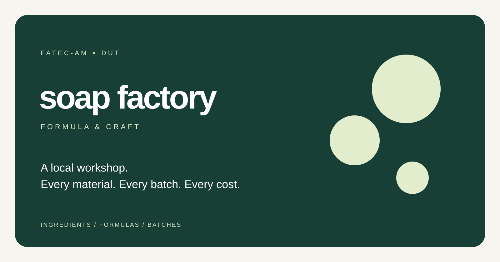
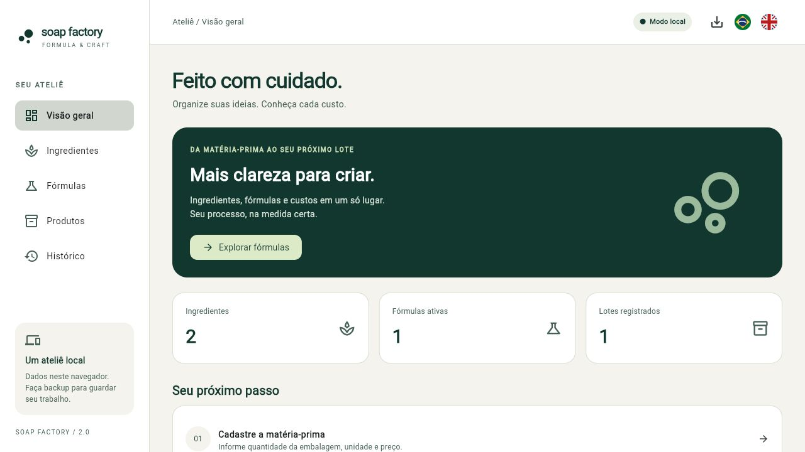
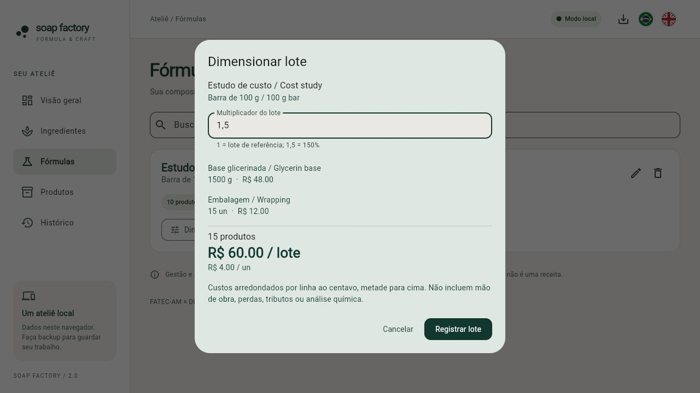
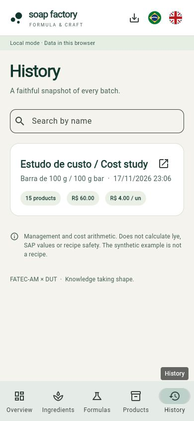

# Soap Factory: a local Flutter workshop for formulas and batch costs

Editorial revision prepared on 2026-11-17. Publication status: see [Medium status](../MEDIUM_STATUS.md). This English revision follows the language of the original repository material; it is not a claim that a corresponding Medium article exists or was updated.



*Locally drawn conceptual cover, not an application screenshot.*

Soap Factory began as a collaborative academic project between Faculdade de Tecnologia de Americana (FATEC-AM) and Durban University of Technology (DUT). This lesson follows its current management application: ingredients and package prices lead to a reference formula, a product yield, scaled batches and a history of costs.

This is a software and arithmetic exercise. The example is synthetic, not a soap-making recipe. The app does not calculate lye, SAP values or chemical safety.

## 1. Run the real application

Use Flutter **3.50.0**, which bundles Dart **3.14.0**, and the committed dependency lockfile. Material components now come from `material_ui` **1.11.1**. Local persistence uses `shared_preferences` **2.5.6**. Flutter's SDK pins some transitive versions; do not force overrides just to match a package catalog.

```sh
git clone https://github.com/kleberandrade/soap-factory-flutter.git
cd soap-factory-flutter
flutter pub get --enforce-lockfile
flutter run -d chrome --web-port 18773
```

Start from the empty workspace. The app has no sign-in or cloud account. Its local-mode notice explains where data is stored. Select **Load example / Carregar exemplo** only if you want the synthetic study data.



*Real capture of the release Web application at 1280 × 720. No production customer data.*

## 2. Model the purchase before computing its cost

An ingredient records the amount in its purchased package, the package unit and package price in BRL. A package of 1 kg at R$32.00 and a reference formula line of 1000 g represent the same mass, so the line costs R$32.00. A package of ten wrapping units at R$8.00 supplies ten products in this synthetic example.

Mass can convert between g and kg; volume between mL and L. Count stays count. The app never infers density, so 1 L cannot silently become 1 kg. Amounts are positive integers representing thousandths of their displayed unit; counted packaging must be whole. Price zero is permitted for deliberately cost-free inputs.

The following source-aligned Dart example defines a purchase:

```dart
final oil = Ingredient(
  id: 'oil',
  name: 'Oil',
  unit: Measure.kg,
  packageQuantity: 1000, // 1.000 kg in thousandths
  priceCents: 2050, // R$20.50
);
```

This is an independent arithmetic fixture in `test/domain_test.dart`. The material name does not imply a valid process or recipe.

## 3. Link a composition to a product yield

In **Formulas**, enter a composition name, a product description and a whole number of output products per reference batch. Add each material once, with a compatible unit and amount. The Products screen provides a product-centered view of these formula records. It is not a stock ledger or a sales catalog.

```dart
final formula = Formula(
  id: 'f',
  name: 'Sample',
  product: 'Bar',
  yieldCount: 10,
  lines: [FormulaLine('oil', Measure.g, 500000)], // 500 g
);
final result = calculate(formula, [oil], 1500); // 1.5 times
```

The result has 750 g, 15 output products and a total cost of 1538 cents. That comes from R$20.50 × 0.75 = R$15.375, rounded half up to R$15.38. The displayed unit cost is R$1.03. These expected values are asserted independently in the tests.

## 4. Make rounding and errors visible

The app first scales amounts to a thousandth of the line unit, then rounds each line cost to cents, then sums those rounded line costs. It calculates displayed unit cost by dividing the total by whole output count, rounded half up again. Integer parsing and BigInt multiplication/division avoid binary floating-point calculation differences between the Dart VM and JavaScript.

A multiplier of zero, excess precision, a fractional product yield, incompatible units, duplicate ingredient lines, or a scale that rounds a line to zero fails validation. The preview explains the constraint and disables recording. Fix the input rather than silently dropping a line.



*Real synthetic example preview. It includes materials only, excluding labor, waste and taxes.*

## 5. Save a historical snapshot

**Record batch** stores the copied formula and product names, scaled material amounts and rounded costs, multiplier, output count and UTC timestamp. Changing the current ingredient price afterward leaves that historical record unchanged. Deleting a formula also preserves history. An ingredient used by an active formula cannot be deleted until the formula reference is removed.



*Real responsive Web capture at 390 × 844, not a physical-device test. Language switching keeps the workspace data.*

## 6. Understand persistence and recover deliberately

The repository adapter saves one schema-versioned JSON document using `SharedPreferencesAsync`. `WorkspaceRepository` is replaceable, so a future backend can implement the boundary with real authentication and authorization. This local adapter is not Firebase, and there is no simulated authentication.

Successful saves update the visible workspace only after storage returns successfully. A write failure retains the earlier state and offers retry. A load failure displays a recovery state and blocks ordinary writes. A valid backup can be explicitly restored after confirmation.

Use **Backup and restore** to copy JSON into a safe file. Restore validates schema, bounds, references and types before asking to replace the current workspace. Invalid backups leave the current data alone. Browser profiles and origins have separate data; use a stable host and port. Clearing browser data can erase the workspace. Use a single editing tab because there is no multi-tab conflict resolution. Storage is unencrypted and browser quotas can be lower than the 5-million-character application limit.

## 7. Verify before extending

```sh
flutter analyze --no-pub
flutter test --no-pub --coverage
flutter build web --release --no-pub --no-web-resources-cdn
```

Run tests and builds sequentially on shared machines. The verified target is release Web in a desktop browser and a narrow mobile-sized viewport. Android/iOS configuration was incrementally migrated but no native build, emulator or physical-device result is claimed. See the validation record for exact checks and limits.

## References and credits

- [Project source and full history](https://github.com/kleberandrade/soap-factory-flutter)
- [Flutter 3.50 release notes](https://docs.flutter.dev/release/release-notes)
- [Material UI migration](https://pub.dev/packages/material_ui)
- [Shared preferences limitations and async API](https://pub.dev/packages/shared_preferences)
- Domain rules: `lib/domain/workspace.dart`; independent fixtures: `test/domain_test.dart`.
- Original team: Gabriel Roveri, Izadora Miranda, Maiara Martins, Maicon Gabriel de Sá, Kleber de Oliveira Andrade, Osvaldo Succi and Mamothibe Thamae. Original institutions and roles remain in the README.
- Copyright 2019–2020 FATEC-AM and DUT, MIT license. Original source/authorship remain in Git history.

## Practical exercises

1. **Compatible purchase units.** Enter one material as 1 kg at R$20.50 and use 500 g in a ten-product formula. Completion: the reference preview costs R$10.25, and switching to a 1000 g purchase preserves the cost.
2. **Invalid inputs.** Try zero, a negative value, four decimal places and a volume unit for a mass material. Completion: invalid input cannot be saved; add a test asserting the corresponding rejection.
3. **Independent rounding fixture.** Scale the previous formula to 1.5. Completion: assert 750 g, 15 products, 1538 batch cents and 103 displayed unit cents without deriving expected values from the calculator under test.
4. **Historical integrity.** Record the batch, double the ingredient price, then delete the formula. Completion: a new preview reflects the new price while the original history still shows the recorded cost and quantities.
5. **Backup and language recovery.** Copy a synthetic workspace backup, switch language, reload, try an invalid backup and restore the valid document after confirmation. Completion: the invalid import changes nothing and the valid restore recovers ingredients, formulas, history and the saved language.
